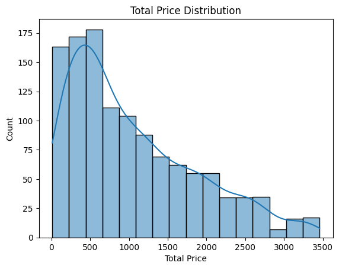
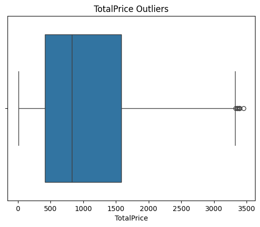
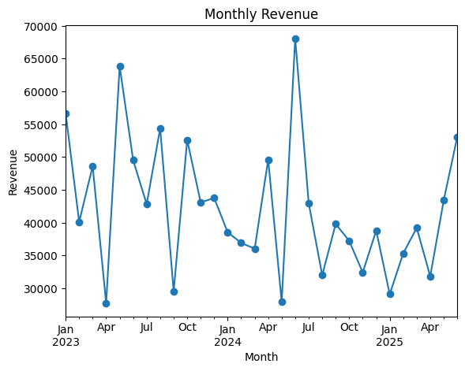
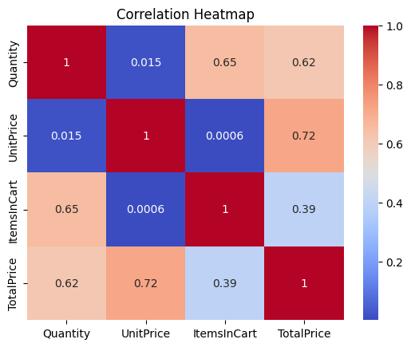

# Exploratory Data Analysis: E-commerce Orders

## Problem Statement
Explore 1,200 e-commerce orders (2023 to 2025) to understand what a typical order looks like, how sales are trending, which orders are unusual, and where revenue is being lost.

## Dataset
`Cleaned_Dataset.xlsx`: 1,200 orders, 14 columns (OrderID, Date, Product, Quantity, UnitPrice, OrderStatus, TotalPrice, etc.). No missing values, no duplicates.

## Methodology
- **Basic stats:** mean, median, count (numeric), mode (categorical), `describe()`
- **Distribution:** skewness and histogram
- **Outliers:** IQR method (robust for skewed business data), checked with a boxplot
- **Trends:** yearly and monthly revenue, order status percentages
- **Relationships:** correlation heatmap

## Key Findings
- **About 41% of orders are Cancelled (20.8%) or Returned (20.6%).** Only 19.3% were Delivered.

- **A typical order is about 824, not 1,054.** TotalPrice is right-skewed (0.89), so the median is more reliable than the mean.

- **8 high-value outliers** in TotalPrice, possibly bulk or VIP buyers. Investigate, don't delete.

- **Average order value is slowly falling:** 1,083 (2023), 1,046 (2024), 1,003 (2025). 2025 is a partial year.

- **Monthly revenue is volatile** (about 28k to 68k) with no clear seasonality.

- **TotalPrice correlates with UnitPrice (0.72) and Quantity (0.62)**, which is expected since TotalPrice = Quantity × UnitPrice.

## Recommendations
1. Find out why orders are cancelled or returned (biggest revenue leak).
2. Study the 8 high-value orders as a possible VIP segment.
3. Track average order value over time.

## Limitations
Correlation is not causation, 2025 data is incomplete, and there are no reason codes for cancellations or returns.

## Tools & How to Run
Python, Pandas, NumPy, Matplotlib, Seaborn. Open `Project2_internship.ipynb` in Google Colab, upload `Cleaned_Dataset.xlsx`, then `Runtime → Run all`.

*Project 2, Data Analytics Internship at DecodeLabs *
